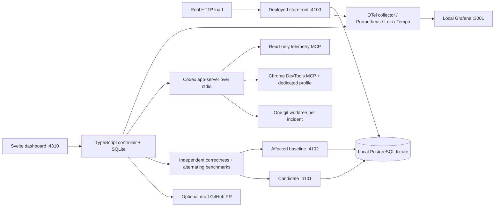

# pulse · a local performance agent

A runnable, visual performance-agent lab. A real storefront slows down, real telemetry crosses a sustained p95 threshold, and **Codex app-server** investigates and edits an isolated application worktree. A deterministic controller—not the model—tests a separate candidate and optionally publishes a draft GitHub PR.

Everything except Codex inference and optional GitHub operations runs on your Mac. No hosted observability, daemon installation, OS scheduler, or cloud job.

## Quick start

Requirements:

- Apple Silicon Mac, **OrbStack** running with its `orbstack` Docker context; Docker Compose v2.
- Node.js 24–26 and npm; Git; Google Chrome 149+ in `/Applications`.
- **Codex CLI 0.155.1**, authenticated with `codex login`. The protocol is pinned to the installed version used to build this project.
- Optional GitHub CLI `gh`, authenticated with `gh auth login`, and an explicitly configured application repository.
- Allow roughly 4 GB free memory for the local stack plus Chrome/model runtime. Initial image downloads require internet.

```sh
cd perf-agent
npm ci
npm run demo
```

The command checks prerequisites and port ownership, prepares an independent local application repository, builds the dashboard, starts the project’s Compose services and local processes, waits for readiness, and opens an authenticated dashboard URL. Leave that terminal running.

1. Click **Start Traffic**. Wait for a healthy, sufficiently sampled p95.
2. Click **Deploy Regression**. Watch the deployment marker, p95 rise, and sustained breach.
3. Open **Investigation** for genuine Codex tool events, browser captures, logs and traces.
4. Open **Fix & Verification** for the patch and baseline/candidate measurements.
5. After independent validation, click **Deploy Candidate Locally**. Recovery is confirmed only after fresh deployed-app measurements cross the recovery band for the configured duration.

The controller never switches off traffic, loosens tests, raises thresholds, or disables telemetry to validate a fix. Threshold editing is locked while an incident is unresolved.

```sh
npm run demo:stop    # stop only owned processes/containers; retain results and volumes
npm run demo:reset   # healthy baseline; archive incident state; preserve all source edits/worktrees
```

Ctrl+C performs the same owned-process cleanup as stop. Offline reset removes **only** this Compose project's database/telemetry volumes and clears its active SQLite state after archiving it. The read-only application fixture is recreated on the next start. Online reset transactionally reseeds the owned database fixture, retains telemetry history, deploys a fresh healthy instance, clears the dashboard’s active incident state, and archives previous state. It does not remove application worktrees, local branches, PRs, or remote branches. Application evidence under `.local/results/` is preserved. Reset requires an explicit click/command; it is never performed on startup.

## Architecture



The controller and storefront run as native Node processes on the Mac. PostgreSQL and `grafana/otel-lgtm:0.36.0` run in OrbStack. No `platform: linux/amd64` override is used; Docker selects native arm64 images. Grafana provisioning, collector configuration, fixtures, scenario revisions, benchmark definitions and controller settings live outside the agent's writable application worktree.

The bundled app is a deterministic 48-product storefront. The fixture models a warehouse round-trip with one **12ms database-side delay per stock query**, identical for every revision. The prepared regression changes query behavior in application source; it is not a telemetry override or runtime feature flag. Exact p95 values vary with hardware and contention. The agent receives the incident, telemetry tools, browser tools and current source, with no prewritten diagnosis or solution in its prompt.

### Monitoring semantics

The monitor and dashboard use `src/metrics.ts` together:

```promql
histogram_quantile(0.95,
  sum by (le) (rate(storefront_request_duration_seconds_bucket{
    service="storefront", route="/api/products", deployment="<current>"
  }[30s])))
```

This aggregates histogram buckets before computing p95. Request rate and sample count use the same route, service, deployment and window. Window sample counts use Prometheus `increase` extrapolation and are displayed as estimates. Server errors are HTTP 5xx over the same request count. Exporter wall-clock heartbeat freshness prevents old points appearing healthy. Low traffic is **insufficient**, stale/failed telemetry is **unavailable**, and both interrupt the sustained-breach timer. Equality with the threshold does not alert. New deployments get new IDs and new windows. Missing polling intervals break sustained evaluation.

The demo defaults are 180ms threshold, 30s window, 20s sustained breach, minimum 50 requests, 12s freshness, recovery below 70% of threshold for 20s, then 60s cooldown. Only one unresolved incident is allowed. Deployment uniqueness and persisted incident/thread IDs prevent duplicate investigations.

```sh
cp config/local.example.json config/local.json
# Edit ignored config/local.json as needed.
PERF_PROFILE=monitor npm run demo  # 5-minute window and slower sustained/cooldown settings
```

Grafana's provisioned dashboard exposes `window` (30s/300s) and deployment selectors. Its queries use the same histogram definition; select the corresponding profile window. The main dashboard always uses the active controller window. Detailed configuration is validated by `src/config.ts`.

### Codex boundary and lifecycle

- `initialize` is acknowledged before `initialized`; JSONL request IDs match responses. Public notifications stream into SQLite and the dashboard.
- One thread/worktree per incident. Investigation and editing are separate schema-constrained turns on that thread. No reasoning items or hidden chain-of-thought are displayed or persisted in dashboard events.
- Chrome DevTools MCP is pinned, uses a separate headless profile per incident, allows only local app/candidate/Grafana URLs, and disables usage statistics and CrUX queries. It supplies browser interaction, network inspection, screenshots and performance traces. No desktop-app computer-use tools are assumed. Coordinate-based screenshot control is an optional Chrome MCP `--experimental-vision` extension, not required by this demo.
- A separate read-only MCP provides PromQL, LogQL and Tempo search/trace reads. Browser and telemetry tool success is required before the editing phase.
- The app-server runs with a dedicated ignored Codex home. A local symlink reuses the existing `~/.codex/auth.json`; user-wide MCP/plugin settings are not imported. Model can be configured, or the authenticated app-server default is used.
- The turn sandbox permits application-worktree writes only, excludes temporary write roots, and disables shell network access. MCP services are separately configured by the controller. The application agent is instructed not to inspect other repositories/history or operate orchestration.
- The configured allowlist of local browser tools is pre-authorized; telemetry tools are annotated read-only. Requests for additional permission escalation are **declined**, recorded, and move the incident to Blocked; there is no automatic full-access approval. Unknown server requests receive an error. Cancellation uses `turn/interrupt`, then shuts down the owned app-server.
- Default budget: 15 minutes and 500,000 reported tokens, maximum two workflow attempts. Token cutoff is checked on usage notifications, so it is a soft cost bound rather than an exact billing cap. A timer interrupts over-budget investigation turns.
- Restarts preserve unfinished work and show Blocked. **Retry same incident** resumes the saved phase/thread. A thread-start intent with no recoverable ID blocks rather than risk duplicate model work. No automatic replay of uncertain side effects. Reset starts a new incident instead of silently reusing a failed one.

### Independent validation

The controller checks that only `src/search.mjs` changed, commits the candidate, and launches immutable git snapshots of the affected baseline and candidate. Both use the same read-only fixture and identical runtime settings. Neither replaces the monitored app.

Correctness checks compare all returned products and fields with independently constructed expected results across empty, matching, no-match, case-insensitive and SQL-like search inputs. Performance runs use real HTTP with a fixed offered rate, warm-up before each run and alternating baseline/candidate ordering. Three 20s measurement rounds per version follow 8s warm-ups. Existing monitored traffic remains unchanged. A run with errors, missed load slots or insufficient samples fails. The aggregate candidate p95 must improve by at least 30%, and every matched round must improve by at least 15%.

Benchmark percentiles use cumulative **client-observed** duration histograms aggregated across rounds. They are explicitly separate from the deployed app's **server-observed** histogram. Results are not averaged percentiles and are not described as production recovery. A passing local candidate is not proof of recovery until it is deployed locally and fresh monitor samples recover.

## Configure a separate GitHub application repository

The framework never publishes to the surrounding research/framework repository. It initializes `.local/application` as an independent Git repository containing only the bundled app, with `main` (healthy) and `demo-regression` (affected). Local workflow works without GitHub; the dashboard shows **publishing unconfigured** and saves a branch plus `.local/results/<incident>/PR.md`.

Create or choose a **dedicated empty application repository yourself**, with your preferred visibility. No repository is created automatically. Then:

```sh
npm run demo:setup
# Replace OWNER/REPO with your explicitly chosen application target.
git -C .local/application remote add demo-target git@github.com:OWNER/REPO.git
git -C .local/application push demo-target main demo-regression
cp config/local.example.json config/local.json
# Set targetRemote to git@github.com:OWNER/REPO.git and targetBase to demo-regression.
gh auth status
npm run demo
```

The target base must exactly match the affected revision, preventing unrelated PRs. Publishing pushes the incident's unique `codex/perf-…` branch without force, looks up any existing PR before creation, then uses `gh pr create --draft`. Retrying checks existing PR state instead of duplicating it. The PR contains symptom/revision, diagnosis, evidence references, changes, correctness checks, methodology, measurements and uncertainties. Sensitive raw screenshots/traces are retained locally, not automatically uploaded. No merging or remote deployment occurs.

## Files and security

- `demo-app/`: standalone bundled application; copied into its own Git repository at setup.
- `src/`: controller, app-server client, monitoring, telemetry MCP, benchmarks, lifecycle.
- `web/`: Svelte/TypeScript dashboard; no CDN fonts/scripts or hosted dependencies at runtime.
- `scenario/`, `fixtures/`, `config/`, `grafana/`: controller-owned, versioned inputs.
- `.local/`: ignored SQLite state, Codex credentials link, profiles, worktrees, releases, logs and evidence. Do not publish this directory.
- `docs/protocol/`: selected schema files generated from the installed Codex CLI 0.155.1.

The dashboard binds to loopback and requires a launch token, exchanged for an HttpOnly SameSite cookie. Browser-agent profiles have no dashboard token. Compose database/telemetry ports bind to loopback. The storefront listens on all host interfaces so the container collector can scrape it; use this synthetic demo on a trusted local network. PostgreSQL credentials are disposable fixture-only values; the app role has SELECT-only access. Use normal `codex login` and `gh auth login`; never put tokens in source/config or commit `.local`.

This is a local demonstration boundary, not a hardened multi-tenant sandbox: MCP processes run with host-user permissions, and candidate application code executes locally. Review changes before adapting this to untrusted repositories or real data. Artifacts may contain source or request data. Inference sends selected evidence to OpenAI.

## Verification

```sh
npm test               # alert, histogram, SQLite, transition and protocol tests
npm run check          # TypeScript + Svelte checks
npm run build
npm run test:protocol  # actual installed app-server initialization/auth/model-list, no model turn
npm run test:e2e       # while demo is running; explicitly resets demo, then real full workflow
```

The end-to-end runner produces `.local/results/e2e.json` only after healthy traffic, a sustained breach, exactly one real investigation, a validated patch and measured deployment recovery. It reports publishing status honestly. It does not fabricate agent events or a PR URL. See [verification record](docs/VERIFICATION.md) for what was actually exercised on the implementation machine.

## Presenter and troubleshooting

See [the 5-step presenter script](docs/PRESENTER.md), [troubleshooting](docs/TROUBLESHOOTING.md), and [sources / dependency pins](docs/SOURCES.md).

## Connect another application

The app-server, SQLite workflow, monitoring and publishing modules are separate from the bundled app. To supply another app, implement a trusted adapter for repository setup and immutable baseline/candidate launch (`src/system.ts`), expected correctness and load requests (`src/benchmark.ts`), editable-path policy (`src/controller.ts`), and metric filters (`src/metrics.ts`). Supply your deployment identifiers and equivalent reproducible fixtures. Configure a separate GitHub remote/base. Do not just point this demo at a production repository: its catalog tests and deployment adapter are intentionally specific to the included storefront.

Current limitations: one app, one route, one active incident; no multi-controller failover or fully automatic crash resume; short local benchmarks are noisy and can block; model diagnosis and patches are not guaranteed; a model may decline or need permission outside the narrow sandbox. Results survive clean shutdown. Abrupt host/process failure can leave child processes needing manual ownership inspection (see troubleshooting). The app-server API is experimental; upgrades require regenerated schemas and protocol/runtime verification.
