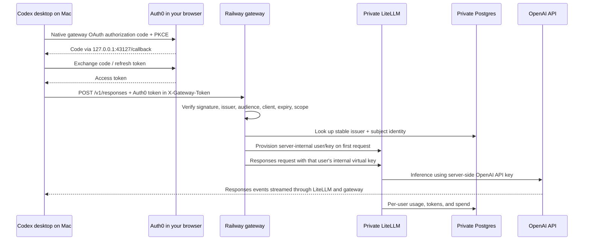

# Codex native OAuth gateway lab

This lab exercises **Codex's native `gateway_oauth` browser login** from the [OpenAI gateway guide](https://learn.chatgpt.com/docs/enterprise/connect-to-a-gateway#use-native-gateway-oauth). It creates a disposable Railway project with an OAuth-validating gateway, LiteLLM, and PostgreSQL. Auth0 hosts the sign-in page. The first version routes configured OpenAI model IDs using an OpenAI API key held by the LiteLLM service.

**This is the single start-to-finish setup guide.** Follow steps 1–8 in order, starting with your existing Auth0 account. Every required Auth0 dashboard action and terminal command is included here; no other project document is required.

1. [Prepare your Mac and local files](#1-prepare-locally).
2. [Set up Auth0 management access](#2-set-up-auth0-management-access).
3. [Create OAuth resources and test users](#3-create-oauth-resources-and-test-users).
4. [Deploy Railway](#4-create-and-deploy-the-railway-lab).
5. [Sign in through your normal Codex desktop app](#5-test-the-actual-codex-desktop-oauth-flow).
6. [Verify per-user tracking](#6-check-per-user-tracking-and-diagnostics).
7. [Restore your usual ChatGPT setup](#7-return-to-your-usual-chatgpt-setup).
8. [Tear down and repeat](#8-tear-down-and-recreate).

Run terminal commands from `/Users/tth/projects/research/railway-litellm-auth0`. Replace uppercase placeholder values with your own values; do not paste passwords or API keys into this chat. Stop at a failed checkpoint and use the troubleshooting table at the bottom before continuing.

**Current status:** local code, configuration, and container checks have passed. Nothing has been deployed to your accounts, and live Auth0/Railway/desktop login remains to be verified by following this guide. Steps 3 and 4 create account resources; model requests use your OpenAI API credit.

## Authentication and scope

**SSO in Codex; API keys only on the server during model requests.**

- **Desktop sign-in:** Codex opens Auth0 in your browser, receives an Auth0 access token, and manages token storage and refresh. You authenticate with your Auth0 account; you are never issued a LiteLLM or OpenAI API key for Codex.
- **Desktop configuration:** the lab's TOML contains the gateway URL, selected model, public OAuth client ID, authorization/token URLs, scopes, callback port, and token-delivery settings. It contains **no OpenAI API key, LiteLLM API key, OAuth client secret, or pasted access/refresh token**. The public client ID is an identifier, not a secret.
- **Server authentication:** the Railway gateway validates your Auth0 token and uses an internal per-user LiteLLM key. LiteLLM tracks that user's usage and applies model access, budget, and rate limits. LiteLLM alone uses the OpenAI API key for upstream inference; these API keys are never returned to Codex or the browser.
- **Model catalog discovery is deferred:** use the explicitly configured `models` and `defaultModel` for this experiment. There is no setup step for automatic discovery, a custom catalog file, or a dynamically populated model picker after SSO. The `/v1/models` endpoint is available for API diagnostics, not automatic Codex picker integration.

The ignored project `.env` used below is **administrator deployment input** on your Mac. It supplies server secrets to Railway and management credentials to Terraform; it is not a desktop authentication file and is not distributed to Codex users.



LiteLLM's built-in JWT authentication is an [Enterprise feature](https://docs.litellm.ai/docs/proxy/token_auth). This lab keeps the same user-facing SSO flow by validating the Auth0 token in the Railway gateway, then authenticating the server-to-server hop with LiteLLM's standard [virtual-key authentication](https://docs.litellm.ai/docs/proxy/virtual_keys). Codex authenticates only with its Auth0 token; the internal LiteLLM key never reaches the client. This tests Codex's native browser OAuth flow and per-user tracking through LiteLLM. It does not test LiteLLM's built-in Enterprise JWT implementation.

## What is created

| Location | Resources | Lifetime |
|---|---|---|
| Railway, native TypeScript IaC | `gateway`, `litellm`, `postgres`, one persistent volume | Disposable project |
| Auth0, Terraform | Native public client, gateway API/scope, isolated password connection | Usually retained between Railway experiments |
| Auth0, one-time setup | Tenant and Terraform management application | Retained; not owned by this lab's Terraform state |
| Auth0, manual test data | Two users in the lab connection | Retained with the connection |
| Mac | Ignored `.env`, `.local/config.json`, project ID, optional Codex backup | Local only |

Only `gateway` receives a public Railway domain. LiteLLM and Postgres have no public domains or TCP proxies in this definition. PostgreSQL uses the official image with a volume; it is a lab database, without a managed HA/backup policy. The region defaults to Singapore. The LiteLLM listener uses IPv4, supported by [new Railway environments](https://docs.railway.com/networking/private-networking/how-it-works).

## 1. Prepare locally

Requirements: Node 22.18+, Python 3.11+, Terraform 1.6+, your Railway and Auth0 accounts, and your existing OpenAI API key. The required runtimes were found on your Mac during preparation. Docker/OrbStack is optional for the integration tests; you do not need it to deploy. The Railway CLI is installed by `npm ci` below.

Open **Terminal.app** so you can continue running commands while Codex is closed later. Check the prerequisites:

```sh
node --version
npm --version
python3 --version
terraform version
```

Each command should print a version, with Node, Python, and Terraform meeting the minimums above. Then initialize the lab:

```sh
cd /Users/tth/projects/research/railway-litellm-auth0
npm ci
npm run lab -- init
```

Edit `.local/config.json` and `.env` in your editor. Both are ignored by Git. `init` generates stable internal secrets and preserves existing files on subsequent runs.

Set `OPENAI_API_KEY` to your existing key in the project `.env` as deployment input. The IaC passes that key only to the LiteLLM service, never into Codex configuration. Leave the generated database password, LiteLLM master/salt, and gateway seed intact. Do not put keys in TOML or commit `.env`. Do not rotate those generated values while keeping the existing database; the gateway detects a changed key seed and fails closed.

In `.local/config.json`, choose your model IDs in `models` and `defaultModel`; `defaultModel` must be one of the entries in `models`. The example uses `gpt-6.1-sol`, which was present in the installed desktop client's model catalog during preparation. Your OpenAI API project must independently have access to whichever models you select. ChatGPT subscription access does not establish API access. Use known Codex model IDs for this test. Automatic model-catalog discovery and custom catalog setup are out of scope; no catalog setup is required to continue.

**Checkpoint:** `.env` and `.local/config.json` exist, your OpenAI key is set in `.env`, and the generated internal secrets remain intact. `oauthClientId` and `gatewayUrl` are filled automatically in later steps; leave them alone for now.

## 2. Set up Auth0 management access

You need two different applications. **Terraform's management app** has a secret and configures Auth0. **Codex's native app** is public and performs browser login without a token-endpoint secret. You create the management app below; Terraform creates the native app in step 3.

### Find your tenant

Open the [Auth0 dashboard](https://manage.auth0.com/). If onboarding has not created a tenant, create a development tenant. Use the region you prefer; the actual domain may end in `us.auth0.com`, `au.auth0.com`, `eu.auth0.com`, or another Auth0 locality. Use the assigned tenant domain, not a custom domain, for this first test. Auth0 describes the tenant/domain relationship [here](https://auth0.com/docs/get-started/auth0-overview/create-tenants).

Use a dedicated development tenant when possible. You can keep it across every Railway teardown. You do not need to create a native Codex app or a custom API manually.

### Create the management application

In the dashboard:

1. Go to **Applications → Applications → Create Application**.
2. Name it `codex-lab-terraform`.
3. Choose **Machine to Machine Applications** and create it.
4. Select **Auth0 Management API** when asked which API it should access.
5. Authorize the following scopes for the resources this lab manages:

   ```text
   read:clients        create:clients        update:clients        delete:clients
   read:client_keys
   read:resource_servers  create:resource_servers  update:resource_servers  delete:resource_servers
   read:connections    create:connections    update:connections    delete:connections
   read:connections_options
   ```

   Connection assignment updates use `update:connections`. `read:connections_options` allows Terraform to read the password/signup settings. If Terraform reports an insufficient-scope error, grant the exact scope it names. You can edit grants later in **Applications → APIs → Auth0 Management API → Machine to Machine Applications**. The official [Terraform quickstart](https://registry.terraform.io/providers/auth0/auth0/latest/docs/guides/quickstart) uses all Management API scopes; the list above limits this application to the resource families used here.
6. Open the application's **Settings**. Copy **Domain**, **Client ID**, and **Client Secret** into the corresponding values in your local `.env`:

   ```dotenv
   AUTH0_DOMAIN=your-tenant.us.auth0.com
   AUTH0_CLIENT_ID=YOUR_TERRAFORM_M2M_CLIENT_ID
   AUTH0_CLIENT_SECRET=YOUR_TERRAFORM_M2M_CLIENT_SECRET
   ```

Use your editor for those values. Keep the domain without `https://` or a trailing slash. These credentials stay on your Mac; they are not sent to the Railway services and do not go in Codex TOML. Keep the application for future Terraform updates/destroy operations.

### Match the local settings to your tenant

In the existing `.local/config.json`, edit these fields, **keeping all other fields**:

```json
{
  "auth0Domain": "your-tenant.us.auth0.com",
  "projectName": "codex-gateway-lab",
  "audience": "https://codex-gateway-lab",
  "scope": "llm:invoke",
  "redirectPort": 43127
}
```

These are fields in the existing file; preserve its other fields. Leave `oauthClientId` alone for now. The audience is an API identifier, so it need not resolve in DNS. Keeping it independent of Railway's generated URL lets you recreate Railway without changing Auth0. Choose a unique audience/project name if you later create another independent lab in this tenant.

**Checkpoint:** `.env` contains your management application's domain, client ID, and secret; `auth0Domain` in `.local/config.json` matches the domain exactly. Do not put the management application's client ID in `oauthClientId`.

## 3. Create OAuth resources and test users

### Apply the Auth0 configuration

```sh
npm run lab -- auth0-plan
npm run lab -- auth0-apply
```

Review the plan and type `yes` when Terraform asks. It creates only the resources in [infra/auth0/main.tf](infra/auth0/main.tf):

| Setting | Value |
|---|---|
| API identifier / audience | `https://codex-gateway-lab` |
| API signing algorithm/profile | RS256 / standard Auth0 access-token claims |
| API permission | `llm:invoke` |
| Access token lifetime | 300 seconds |
| Allow Offline Access | Enabled |
| Native application | `codex-gateway-lab-codex` |
| Token endpoint authentication method | `none` |
| Grants | Authorization Code, Refresh Token |
| Callback | `http://127.0.0.1:43127/callback` |
| Refresh tokens | Rotating; seven-day absolute / one-day idle expiry |
| Password connection | `codex-gateway-lab-users`; self-registration disabled |

The wrapper writes the native application's public client ID into `oauthClientId`. **Do not replace it with the management application's client ID.** The native client secret is not used or distributed.

This matches [Auth0's native PKCE requirements](https://auth0.com/docs/get-started/authentication-and-authorization-flow/authorization-code-flow-with-pkce/call-your-api-using-the-authorization-code-flow-with-pkce) and [Codex's gateway OAuth settings](https://learn.chatgpt.com/docs/enterprise/connect-to-a-gateway#use-native-gateway-oauth). Codex supplies the PKCE challenge/verifier; you do not implement that in an external login helper.

**Checkpoint:** Terraform finishes successfully and `.local/config.json` now contains an actual `oauthClientId`, replacing `SET-BY-AUTH0-OUTPUT`. In the Auth0 dashboard, the native application, API, and lab password connection listed above exist.

### Create two users for the experiment

1. Open **Applications → Applications → codex-gateway-lab-codex → Connections**. Ensure `codex-gateway-lab-users` is enabled. For a lab restricted to these users, disable any other connections that Auth0 automatically enabled for this new native client. Do not change connections for the management application or unrelated apps.
2. Go to **User Management → Users → Create User**.
3. Select connection **codex-gateway-lab-users**. Create a user with an email address you control and a password.
4. Create another user in that same connection, using another address/alias you control. Complete email verification if your tenant's policies require it.

Your Auth0 dashboard/admin login is not automatically an application test user. Log in with these newly created users when Codex opens the lab login page. Self-registration is intentionally off; there is no public signup path to consume your OpenAI credit.

**Checkpoint:** two test users appear in **User Management → Users**, both in `codex-gateway-lab-users`. Keep their credentials available for the browser login. The names throughout this guide assume the default `projectName`; if you changed it, use your corresponding resource names.

## 4. Create and deploy the Railway lab

```sh
npm run railway -- login
npm run lab -- railway-create
npm run lab -- plan
```

Complete Railway's browser login and select your workspace when prompted. Review the plan: it should contain this lab's `gateway`, `litellm`, `postgres`, and database volume. Then deploy:

```sh
npm run lab -- up
npm run lab -- status
```

**Checkpoint:** `up` prints `Gateway is ready: https://…up.railway.app`. `status` shows a `projectId` and the same `gatewayUrl`. In the Railway dashboard, all three services should be running and only `gateway` should have a public domain. If deployment fails, inspect its logs using the troubleshooting commands below; keep the recorded state and retry `up` after fixing the problem.

`railway-create` always creates a fresh project and records its ID. `plan` and `up` check that the currently linked project matches that recorded ID/name. `up` applies `.railway/railway.ts`, uploads the two local Docker build contexts, creates/reuses the gateway domain, and waits for readiness. No GitHub push is needed. Re-running `up` updates the same project.

The Railway IaC engine manages infrastructure state remotely; `.local/railway-state.json` records which project this lab owns. Keep that file. Terraform owns the Auth0 state in `infra/auth0/terraform.tfstate`; keep it private and retain it until you have destroyed its resources. Do not delete state as a way to reset either system.

Railway and API usage are billed to your accounts. The gateway provisions each user's key with a default $5/30-day budget and 30 requests/minute. These are LiteLLM controls, not a guaranteed hard cap on your overall provider or Railway bill. Usage accounting can lag requests. Adjust the defaults before first login; changing them later does not rewrite already-issued users/keys.

## 5. Test the actual Codex desktop OAuth flow

Generate the exact proposed configuration first:

```sh
npm run lab -- codex-config
```

Inspect `.local/codex.config.toml`. [codex/config.example.toml](codex/config.example.toml) shows its shape. The important block is `model_providers.railway-auth0-lab.gateway_oauth`: Auth0 authorization/token URLs, public client ID, scopes, fixed loopback port, and custom token header. Auth0's `audience` and dedicated `connection` are included in the authorization URL. There are no API keys, OAuth client secrets, or saved tokens in this generated TOML. The lab provider authenticates through `gateway_oauth`; do not add a static key or credential helper for it.

**Checkpoint:** the generated TOML contains your Railway HTTPS URL, configured model, and Auth0 public native client ID. It contains no unresolved placeholders, API keys, client secrets, or access/refresh tokens. Generating it has not yet changed your active Codex configuration.

Keep this guide open in an editor or browser and use **Terminal.app** for the following steps; the Codex app will be fully closed:

1. Finish/save active Codex work, then **fully quit Codex with Cmd-Q**.
2. Run `npm run lab -- codex-install`.
3. Open your normal installed Codex desktop app.
4. Follow **Codex's gateway sign-in prompt** to open the browser. Sign in as a lab Auth0 user, then return to Codex. Codex obtains the token automatically; do not copy a token or API key into TOML. A prior browser session may make sign-in shorter.
5. Create a new chat in a harmless test directory. Ask: `Reply with exactly: gateway-ok`.
6. Ask it to read a small file in that directory and summarize it, then ask a follow-up about the contents. This checks streaming, a real tool call, and continuation through the gateway.
7. Wait beyond the five-minute access-token lifetime and make another request. Confirm that Codex refreshes the grant and the same user is attributed. If the session can no longer refresh, Codex should request sign-in again.
8. Continue to step 6 to check the matching usage records. A reply by itself does not prove which provider handled it.

`codex-install` changes the effective top-level model/provider, disables web search for this initial qualification, adds the native OAuth provider, and retains unrelated TOML settings/comments. It saves the original bytes in a private ignored backup. Active CLI profiles, managed workspace requirements, or trusted project configuration can override user configuration; the installer refuses an explicit default profile, and you must verify the active provider in the client. WebSockets, voice, and non-Responses routes are outside this first version.

There is no browserless/device-code fallback for this native flow. The browser must reach `http://127.0.0.1:43127/callback`. A port conflict or callback mismatch prevents login.

**Checkpoint:** the browser visited your Auth0 tenant, returned to Codex, and a new chat successfully completed the reply, file/tool task, follow-up, and post-expiry request. Confirm the matching usage records in step 6. If this fails or you need your usual setup immediately, follow step 7 to restore it before troubleshooting.

## 6. Check per-user tracking and diagnostics

In the Railway PostgreSQL service's SQL/data interface, run:

```sql
SELECT i.subject, i.id AS litellm_user_id, s.model,
       COUNT(s.request_id) AS requests,
       COALESCE(SUM(s.total_tokens), 0) AS tokens,
       COALESCE(SUM(s.spend), 0) AS spend_usd
FROM gateway_lab.identities AS i
LEFT JOIN "LiteLLM_SpendLogs" AS s ON s."user" = i.id
GROUP BY i.subject, i.id, s.model
ORDER BY i.subject, s.model;
```

If the service UI does not provide a query editor, open a terminal in the project folder and run:

```sh
npm run railway -- ssh --service postgres
```

Inside the remote service shell, start the database client:

```sh
psql -U litellm -d litellm
```

Paste the SQL above. When finished, enter `\q` to leave `psql`, then `exit` to return to your Mac. This stays inside the Railway network. Allow time for LiteLLM's spend-log batch to flush. Identity uses **issuer + `sub`**, not mutable email. Refreshing a token retains the same identity. Two Auth0 subjects produce two LiteLLM users/keys.

The gateway never forwards a user request to LiteLLM with its master key. Its admin credential is used only during first-request provisioning. A database transaction/advisory lock serializes concurrent first logins. Deleting/revoking a previously issued LiteLLM key does not silently regenerate it. Existing keys retain their own allowlists/budgets, so adding a model to the global list may also require updating existing keys through LiteLLM administration.

**Checkpoint:** the query shows your Auth0 user's `sub` as `subject`, a stable LiteLLM user ID, and the model with request/token/spend data. You can match `subject` to **User Management → Users → your user → user_id** in Auth0. After the five-minute refresh check, additional requests should appear under the same ID.

### Check the second user's attribution

To verify both users without depending on the desktop client's account-switching UI, fully quit Codex first to release the callback port, then run:

```sh
npm run lab -- smoke
```

This independent diagnostic opens Auth0, keeps tokens in memory, tests a refresh grant, rejects an invalid token/model, and makes three small inference requests to check a completed Responses stream and a function-call/result loop. Run it once for the first user, then run the same command again and sign in with the second user's credentials. It requests a fresh login each time. The smoke command uses API credit.

Run the SQL query again after logs flush. **Checkpoint:** you see two different Auth0 subjects with separate LiteLLM IDs and usage rows. Token refresh retains each user's identity. This diagnostic verifies gateway behavior; **it does not substitute for the native desktop login in step 5**.

Only `GET /v1/models` and `POST /v1/responses` are exposed, plus health endpoints. The proxy bounds request size, strips credential/routing/identity overrides, does not log request bodies/tokens, and forwards SSE chunks without buffering the complete response. LiteLLM prompt/response storage in spend logs is disabled; usage metadata remains. This is a research lab, not a production identity platform: JWT checks do not provide instant Auth0 revocation of already-issued access tokens. Access tokens expire after five minutes (plus a small clock tolerance); use key revocation for the model-access layer and revoke Auth0 sessions/refresh tokens as appropriate.

## 7. Return to your usual ChatGPT setup

| Mode | Selected model provider | Credential used for model requests | Inference billing |
|---|---|---|---|
| Your usual configuration | Whatever was selected before the lab | Your usual ChatGPT sign-in | Your existing ChatGPT arrangement |
| Lab configuration | `railway-auth0-lab` | Codex sends an Auth0 access token; the server handles internal LiteLLM keys | Your OpenAI API project |

The lab selects `requires_openai_auth = false`: inference uses the gateway's provider key. Gateway OAuth is independent of ChatGPT sign-in. The configuration switch does not edit `auth.json`, delete your ChatGPT credentials, or sign you out. The gateway strips any incoming ChatGPT authorization/account headers before contacting LiteLLM. Account-dependent plugins or other workspace features may behave differently while using a standalone provider.

Fully quit Codex with **Cmd-Q**. From **Terminal.app**, restore your original configuration:

```sh
cd /Users/tth/projects/research/railway-litellm-auth0
npm run lab -- codex-restore
```

**Reopen the same installed Codex app** and start a new chat to check your usual setup.

The original TOML is restored exactly. If it changed after installation, restoration refuses to overwrite those later edits. Your original is retained at `.local/codex-config.before.toml`; merge it manually with your current configuration to preserve any intervening edits. Your normal stored sign-in can be reused if it remains valid. Codex manages the separate gateway grant in its credential storage; restoring the provider configuration does not revoke that grant. Revoke it through Auth0 if needed.

This lab uses one active provider configuration at a time, with an app restart when switching. It does not promise two independent simultaneous instances or per-chat provider isolation. OpenAI also documents [gateway OAuth alongside ChatGPT workspace sign-in](https://learn.chatgpt.com/docs/enterprise/connect-to-a-gateway#enable-chatgpt-sign-in-recommended), with managed workspace requirements and distinct credential paths. That is a separate rollout configuration; keep it separate from this API-billed test.

**Checkpoint:** your usual model/provider is active again and a normal ChatGPT-backed chat works. If you never ran `codex-install`, skip `codex-restore`: there is no lab backup to restore.

## 8. Tear down and recreate

Complete step 7 before deleting the gateway. Show the owned project ID:

```sh
npm run lab -- status
```

Copy the `projectId` from that output and replace `THE_RECORDED_PROJECT_ID` below with it:

```sh
npm run lab -- down --confirm THE_RECORDED_PROJECT_ID
```

`down` permanently deletes that Railway project, including PostgreSQL data, usage history, services, and the volume. It refuses a mismatched project ID/name and does not silently delete a different linked project. It retains Auth0 so a new Railway deployment can reuse the same public OAuth client and callback. The OAuth API audience is a stable identifier, not the generated Railway hostname.

**Checkpoint:** the command prints `Railway project deleted`, and that project is absent from the Railway dashboard. `status` now reports `No owned project state`, which is expected after deletion. Your Auth0 setup is still present.

### Repeat the experiment

Keep `.env`, `.local/config.json`, and the Auth0 Terraform state. You do not need to redo Auth0 or create users. From the project directory:

```sh
npm run lab -- railway-create
npm run lab -- plan
npm run lab -- up
npm run lab -- codex-config
```

The new domain is written to local config. Repeat step 5, including fully quitting Codex and running `npm run lab -- codex-install`, then repeat the tracking and restore checks. The new database starts with fresh usage/key records; there is no recovery of data from a destroyed lab.

### Optional: remove the Auth0 lab as well

After Railway is deleted and Codex is restored, run:

```sh
npm run lab -- auth0-destroy
```

Review the Terraform deletion plan and type `yes` only when you intend to delete the lab identity resources. This removes the lab client/API/connection, including the connection's test users. It keeps the Auth0 tenant and manually-created Terraform management application. Keep both state files until the respective deletion succeeds. If you want another lab after this full identity reset, repeat step 3 to recreate OAuth resources and users, then steps 4–8. Do not delete the management application before Terraform cleanup; Terraform needs its credentials to delete the resources.

**Finished:** your usual Codex setup is restored, the Railway project is gone, and the Auth0 lab resources are either retained for the next run or removed according to your choice above.

## Troubleshooting and optional developer checks

The setup walkthrough ends above. These local checks are optional when you want to change or debug the implementation:

```sh
npm run check
npm test
terraform -chdir=infra/auth0 init -backend=false
terraform -chdir=infra/auth0 validate
npm run test:integration
```

The integration suite creates randomly named local Docker containers with fake credentials, checks real LiteLLM/Postgres user/key behavior, and deletes those containers/data in `finally`. It makes no paid inference calls. The Railway CLI's archive dependency is overridden to a patched version; keep the lockfile and verify CLI startup when changing it.

Preparation on 2026-11-03 verified the installed app version `26.1027.61615` and its bundled CLI `0.166.0-alpha.5.1`. A temporary command-line provider override returned `required: true`, `status: notReady`, `error: null` from `account/gatewayOAuth/read`. That establishes configuration recognition, **not completed browser login**. See [VALIDATION.md](VALIDATION.md) for the exact checks and remaining live qualification.

| Problem | Check |
|---|---|
| Auth0 callback mismatch | Exact `http://127.0.0.1:43127/callback`; `localhost` is different |
| Login succeeds, gateway returns 401 | Auth0 API audience, RS256, standard Auth0 access-token profile, issuer trailing slash |
| Gateway returns 403 | `llm:invoke` scope, native client's `azp`, model allowlist, or revoked internal key |
| Gateway returns 503 | PostgreSQL/LiteLLM readiness, internal secrets, provisioning failure or changed seed |
| Browser login is denied | Auth0 **Monitoring → Logs**; match callback, native client, and enabled connection; never copy tokens into diagnostics |
| Auth0 management returns 403 | Missing Management API scopes on the Terraform application; use the scope named in the error |
| App still uses usual provider | Full restart; managed/project/profile overrides; active model/provider |
| Switching users in browser does nothing | Codex may still hold a valid gateway grant; browser logout alone does not clear it |
| Model is unavailable | OpenAI API project access and exact model ID; ChatGPT access is separate |
| Missing usage rows | Confirm route/model, successful request, and spend-log flush; health checks are not inference |
| Railway upload/build fails | `npm run railway -- logs --service gateway --build`; likewise `litellm` |

The backend maps the configured model IDs to `openai/<id>`. To add a different provider later, extend `litellm/render_config.py`, add its server-side secret to IaC, and supply accurate Codex model metadata for custom aliases. Re-run streaming and tool-loop tests for every new model/provider combination.

## References

- [Codex native gateway OAuth and macOS setup](https://learn.chatgpt.com/docs/enterprise/connect-to-a-gateway)
- [Codex gateway compatibility requirements](https://learn.chatgpt.com/docs/enterprise/gateway-compatibility)
- [Railway native IaC](https://docs.railway.com/infrastructure-as-code) and [reference](https://docs.railway.com/infrastructure-as-code/reference)
- [LiteLLM virtual keys](https://docs.litellm.ai/docs/proxy/virtual_keys)
- [Auth0 native PKCE flow](https://auth0.com/docs/get-started/authentication-and-authorization-flow/authorization-code-flow-with-pkce/call-your-api-using-the-authorization-code-flow-with-pkce)
