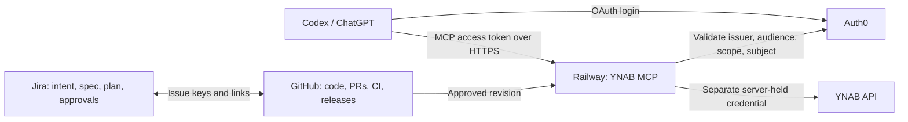

# YNAB MCP on Railway: a resumable Codex/Jira delivery guide

Build a personal YNAB MCP server in a **separate GitHub repository**, host it on Railway, and connect it to Codex and ChatGPT. Use Jira as the authoritative record for requirements and decisions, with two-way links to implementation in GitHub.

**Status: planning documentation only.** This folder does not contain an implemented server. The public application repository was created during guided setup on 7 November 2026 with a minimal README. Account access and client eligibility have been checked, and the existing Jira project now uses YNAB. Jira workflow/integration, Auth0 configuration, Railway deployment and end-to-end client connections remain pending; follow PROGRESS.md for current execution state. Ticket identifiers such as `YNAB-123` remain examples until Jira assigns actual issues. Sources were checked on **6 November 2026**; verify changing UI labels, eligibility, prices and SDK versions when you execute a phase.

## Start here

1. Read [preflight and machine setup](00-preflight.md).
2. Fill the non-secret resource register and checkboxes in [PROGRESS.md](PROGRESS.md).
3. Follow the chapters below in order. Each checkpoint needs observed evidence before it is marked complete.
4. At the end of a session, commit and push the progress update. On another machine, pull it and use [resume instructions](06-operate-and-resume.md).

| Phase | Follow this chapter | You finish with |
| --- | --- | --- |
| 0 | [Preflight](00-preflight.md) | Account/client eligibility checked; local tools ready |
| 1 | [Jira and GitHub](01-jira-and-github.md) | Jira Free space, separate repo and integration configured; link test follows the first PR in Phase 2 |
| 2 | [Codex delivery workflow](02-codex-workflow.md) | Reusable issue/approval/PR conventions and first accepted plan |
| 3 | [Build the server](03-build-server.md) | Tested local server using synthetic data |
| 3a | [Configure authentication](03a-authentication.md) | Auth0 resource/API and distinct clients; protected server |
| 4 | [Deploy to Railway](04-railway-deployment.md) | Stable HTTPS endpoint, initially serving fixtures |
| 5 | [Connect both clients](05-client-connections.md) | Codex and ChatGPT authenticated end-to-end; then YNAB live read smoke test |
| 6 | [Operate, resume, and extend](06-operate-and-resume.md) | Repeatable new-machine setup, rollback, maintenance and later automation |

Phases 3a–5 have one intentional loop: create the Railway domain using fixture mode, register that exact URL and the client callbacks with Auth0, then complete authentication testing. Do not attach a real YNAB token until the public endpoint rejects unauthorized access and both clients pass the fixture checks.

## Agreed repository workflow

On 7 November 2026, the owner selected **public `tzehon/ynab-mcp`**, with all changes submitted through feature branches and pull requests. **Do not push directly to `main`.** Configure Codex cloud automatic code review before the first implementation PR, and verify review of the latest revision before merging. Account-specific setup details and credentials stay in 1Password. The public repository now exists with its GitHub-created README seed; Codex cloud review and branch protection still need configuration and verification. This PR-only policy applies to ynab-mcp; research progress updates may be pushed to main.

## Recommended first release

- One owner, one allowlisted identity, one hosted service, read-only YNAB tools.
- Node.js LTS + TypeScript + the current stable official MCP TypeScript SDK, with exact versions captured in the application repository.
- Streamable HTTP at `/mcp`, a minimal `/healthz`, external Auth0 authentication, and a server-held YNAB personal access token.
- No database or persistent Railway volume for the first release. Request handling is stateless; caches are disposable and credentials live in managed stores.
- Jira intent/spec/plan approval, GitHub PRs and CI, explicit release verification. Begin with manual stage transitions.
- Use Jira's Development panel and GitHub links first. A custom traceability dashboard is a later optional ticket.

These are starting decisions, not already approved product requirements. Confirm them in your first Jira intent. Writing to YNAB, multiple users, custom UI, and autonomous incident repair are separate later scopes.

Auth0 and YNAB credentials are different. Your MCP server does not need an OpenAI API key to expose YNAB tools. Your normal Codex/ChatGPT access is separate; optional Codex review jobs in CI may require API credentials and billing.

## Where records belong

| Record | Authoritative home |
| --- | --- |
| This reusable guide and portable setup index | `research/ynab-mcp-sdlc-guide/` |
| Intent, specification, plan, acceptance criteria, approval | Jira issue |
| Source, tests, lockfiles, operating instructions, PR review | Existing `ynab-mcp` repository |
| Read-only copy of an approved specification used by CI | Evidence artifact referenced from Jira/PR, labelled with revision/hash |
| Tokens, passwords, client secrets | Password manager, Railway variables or appropriate client credential store |

The progress file stores links and checkpoints, not a second specification. If the research repository is public, keep sensitive resource identifiers in a private register and put only its password-manager item name in PROGRESS.md. Neither repository should contain transaction exports, real payees, balances or authentication material.

## Ask Codex to guide one session

> Read this guide's README and PROGRESS.md. Inspect the current resources before suggesting creation. Identify the first incomplete checkpoint and its prerequisites. Help me complete that phase, use the linked Jira issue as the authoritative specification, and stop at a decision that needs my input. Record only outcomes you verified. Do not recreate existing accounts/projects or mark a planned action complete.

Useful starting templates: [Jira issue](templates/issue.md), [application AGENTS.md](templates/AGENTS.md), [PR description](templates/pull_request_template.md), and [initial backlog](templates/backlog.md).

## Validation of this guide

This is an authored implementation plan, not a tested deployment. Local document links and examples are reviewed before commit. Real OAuth exchange, YNAB API access, Railway deployment and both client integrations remain acceptance work in the phases below. References are placed near the instructions they support; follow their current versions if provider interfaces change.
